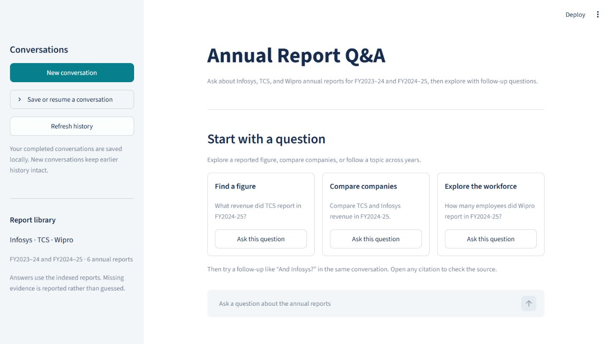

# Annual Report Q&A

A conversational RAG application for asking questions and comparing figures across
**Infosys, TCS, and Wipro annual reports**. Answers include source excerpts and
clickable PDF pages. When the available evidence cannot support an answer, the
application abstains.

Built with **Python, FastAPI, Streamlit, Qdrant, SQLite, Sentence Transformers,
PyMuPDF, and Groq**.



## Features

- **Document ingestion:** manifest-backed PDF identity, checksums, text repair,
  and prose/table-aware chunks with company, fiscal year, and page metadata.
- **Hybrid retrieval:** BGE-small embeddings and BM25 candidates combined with
  reciprocal-rank fusion, then cross-encoder and rank-ensemble reranking.
- **Grounded answers:** structured model output, server-resolved source excerpts,
  citation validation, and evidence-based abstention.
- **Comparisons:** scoped retrieval for each company/year, checks for compatible
  metric definitions and units, and deterministic differences and percentages.
  Partial answers identify missing sides instead of inventing figures.
- **Conversation history:** SQLite persistence and contextual follow-up rewriting,
  with session isolation and clarification handling.
- **Guided interface:** clickable starter questions, a compact conversation sidebar,
  and distinct answer, calculation, and source sections.
- **Source inspection:** open a cited PDF page in the chat, browse nearby pages,
  or download the original report.

## Architecture

```text
Annual-report PDFs -> extraction and text repair -> metadata-aware chunks
                                      |
                              BGE embeddings + Qdrant
                                      |
Streamlit -> FastAPI -> session history -> standalone question
                                      |
                           dense search + BM25
                                      |
                       RRF candidates -> reranking
                                      |
                    scoped evidence + source excerpts
                                      |
                     Groq structured answer generation
                                      |
                 citation / comparison checks + calculations
                                      |
                    answer or abstention -> SQLite -> UI
```

The application uses `source-excerpts-v1` citation selection and `balanced-v1`
comparison retrieval. Single-side searches use five evidence passages by default;
comparisons retrieve each requested side separately. The model selects excerpt
IDs, and the server resolves them to source text. One citation-repair attempt is
allowed. See the [developer reference](docs/development.md) for details.

## Corpus

The current local corpus contains **six reports and 6,834 indexed chunks**.

| Company | Fiscal year | Document ID | PDF pages |
|---|---|---|---:|
| Infosys | 2023–24 | `infosys_fy2024` | 352 |
| Infosys | 2024–25 | `infosys_fy2025` | 369 |
| TCS | 2023–24 | `tcs_fy2024` | 340 |
| TCS | 2024–25 | `tcs_fy2025` | 336 |
| Wipro | 2023–24 | `wipro_fy2024` | 481 |
| Wipro | 2024–25 | `wipro_fy2025` | 520 |

[data/manifest.json](data/manifest.json) records the source URLs, exact filenames,
SHA-256 hashes, and page counts. Raw PDFs, processed data, model caches, and the
Qdrant volume are not included in Git.

## Quick start

Requirements: Python **3.11 or 3.12**, Docker, a **Groq API key**, and enough local
memory for the embedding and reranking models. Initial model downloads and Groq
requests require internet access. The commands below use PowerShell.

### 1. Install and configure

```powershell
git clone https://github.com/KMD-Gouse/rag_assistant.git
cd rag_assistant
py -3.12 -m venv .venv
.\.venv\Scripts\Activate.ps1
python -m pip install --upgrade pip
python -m pip install -e ".[dev]"
Copy-Item .env.example .env
```

Set `GROQ_API_KEY` in `.env`. Keep `.env` private. The default generation model is
`openai/gpt-oss-20b`; other settings are documented in [.env.example](.env.example).
If you already have a configured `.env`, keep it instead of copying over it.

### 2. Prepare the reports and index

Download each PDF from its `source_url` in [the manifest](data/manifest.json) and
save it under `data/raw/` using its exact `filename`. Ingestion expects these
files to exist; it does not download them. Check downloaded files against the
manifest hashes, for example with `Get-FileHash data/raw/infosys_fy2025.pdf -Algorithm SHA256`.

Start Docker Desktop, then run:

```powershell
docker compose up -d
python -m app.ingestion.pipeline --all
```

The collection is `annual_report_chunks`. Skip ingestion when your existing
Docker volume already contains the indexed reports. Ingestion can take time
because it parses, chunks, embeds, and indexes all six PDFs.

### 3. Start the application

```powershell
.\start_all.ps1
```

Open **[the chat interface](http://127.0.0.1:8501)** or
[the interactive API documentation](http://127.0.0.1:8000/docs).

The launcher starts local services in the background, reuses healthy instances,
and waits for HTTP availability. Logs and process IDs are saved in `tmp/`.
HTTP availability does not prove that the corpus or model provider is ready.
The first answer loads retrieval models and may take longer.

For separate terminals or other operating systems, with the virtual environment
activated and Qdrant running:

```sh
python -m uvicorn app.api.main:app --host 127.0.0.1 --port 8000 --workers 1
```

```sh
python -m streamlit run ui/streamlit_app.py --server.address 127.0.0.1
```

The UI uses `http://127.0.0.1:8000` by default. Set the `RAG_API_URL` process
environment variable to override it; the UI does not load `.env`.

## Try the demo

Use a new conversation for independent questions; keep the follow-up in the same
conversation as the first question.

| Scenario | Question or action | Expected behavior |
|---|---|---|
| Factual question | What revenue did TCS report in FY2024-25? | Answer with supporting citations |
| Follow-up | And Infosys? | Preserves revenue and year, switches company |
| Comparison | Compare TCS and Infosys revenue in FY2024-25. | Sources for both sides and a checked calculation |
| Unsupported question | What revenue did Apple report in FY2024-25? | Abstains because evidence is unavailable |
| Source inspection | Click a citation below an answer | Opens the original PDF at the cited page |
| Conversation history | Refresh history or resume with the session ID | Restores completed turns |

The [recorded demo checks](evaluation/results/application-demo-checks-2026-11-06.json)
passed on November 6, 2026. A rate-limited request succeeded after waiting.
These checks demonstrate selected flows; they are not an accuracy benchmark.
See [the UI guide](ui/README.md) for source viewing and session behavior.

## Evaluation and results

**These scores belong to the frozen historical baseline, not the current app.**
The retrieval freeze used **4,083 chunks**; the current corpus and application
have since expanded. New excerpt selection, recovery, comparisons, and follow-up
rewriting have not received a fresh held-out end-to-end accuracy evaluation.

| Historical challenge metric | Result | Evaluation scope |
|---|---:|---|
| Retrieval evidence recall@5 | **88.24%** | 17 answerable questions in a 20-question challenge |
| Retrieval all-evidence hit@5 | **82.35%** | Same retrieval challenge |
| Human-reviewed end-to-end success | **70% (14/20)** | Separate 20-question generation challenge |
| Generated-answer correctness | **90% (9/10)** | Only the ten generated challenge answers |
| Unanswerable-question abstention | **100% (6/6)** | Six unanswerable generation-challenge questions |

The generation challenge's 14 successes comprise eight fully correct and
supported answers plus six correct abstentions. Four answerable questions were
incorrectly withheld; the remaining generated answers included an incorrect
answer and an answer with inadequate citation support. These failures are
retained in the reported results.

Configurations were frozen before challenge evaluation. Tuned development
scores are kept separate from challenge scores. The small challenge sets do
not establish population-wide accuracy.

- [Evaluation details and reproduction commands](docs/evaluation.md)
- [Retrieval benchmark design](evaluation/benchmark_v2.md)
- [Retrieval challenge analysis](evaluation/results/benchmark-v2-challenge-analysis.md)
- [Human-reviewed generation challenge](evaluation/results/week6-generation-challenge.md)
- [Generation provenance](evaluation/results/week6-generation-challenge-provenance.json)

Historical filenames and Git tags retain their week labels for traceability.
Reproducing a historical result requires its recorded code, corpus, and settings;
running the current app is a different experiment.

## Tests

```powershell
# Offline tests: mocked provider calls and isolated storage
python -m pytest -m "not integration" -q

# Integration tests: running Qdrant with the indexed corpus and retrieval models
python -m pytest -m integration -q

# Both suites
python -m pytest -q
```

The last full verification on November 6, 2026 passed **291 tests**. Tests cover
parsing, chunking, retrieval, ranking, citation validation, comparison calculations,
rewriting, history, API behavior, and the Streamlit interface. Mocked generation
tests validate contracts, not the accuracy of arbitrary live model responses.

## Troubleshooting and limitations

- **Slow first answer:** models load on demand. Once both models are cached, set
  `$env:HF_HUB_OFFLINE = "1"` before starting the API to skip model-host metadata
  requests. Do not use this on a fresh installation. Remove it with
  `Remove-Item Env:HF_HUB_OFFLINE` when model downloads are needed. Groq still
  requires internet access.
- **Rate limit or timeout:** wait after HTTP 429. After a timeout, refresh history
  before resending; the original request may have completed. Requests are not
  automatically deduplicated.
- **Restart after changes:** the launcher reuses running services without
  reloading code. Inspect the PID in `tmp/api.pid` or `tmp/ui.pid`, confirm its
  identity with `Get-Process`, then stop that service with `Stop-Process -Id <PID>`
  and rerun the launcher.
- **Local Qdrant:** plain HTTP `localhost` connections use IPv4 to avoid Windows
  connection delays. The verified client/server versions emit a compatibility
  warning; live integration tests passed. A Starlette/AnyIO deprecation warning
  can also appear in tests.
- **Evidence limits:** a quote existing in a source does not prove that it entails
  every answer claim. Model mistakes and false abstentions remain possible.
  Evidence sufficiency is not a calibrated probability.
- **Comparison limits:** figures must have compatible definitions, years, and
  units. Missing sides may be returned as explicitly partial answers; arithmetic
  is only produced for validated pairs.
- **Local-use architecture:** use one API worker. Session guards and the shared
  inference lock are process-local. The API has no authentication, and knowing a
  session ID does not prove ownership.

## Deployment status

The supported setup is a local demo. A hosted version needs the Streamlit UI,
FastAPI backend, Qdrant index, model files, original PDFs, and persistent history
storage. Hosting the UI alone does not host the backend. Before shared public
use, add authentication, session ownership checks, and usage controls for the
model-provider quota. Multi-worker deployment also needs shared coordination.

## Repository layout

```text
app/
  ingestion/          PDF parsing, repair, chunking, embedding, indexing
  retrieval/          Dense search, BM25, RRF, scope inference, reranking
  generation/         Structured generation, citations, comparison validation
  api/                Chat, history, health, and PDF endpoints
  memory/             SQLite history and follow-up rewriting
data/manifest.json    Source URLs, filenames, hashes, report metadata
evaluation/           Benchmarks, runners, results, reviews, frozen configs
ui/                   Streamlit interface and HTTP client
tests/                Offline and integration tests
docs/                 Developer and evaluation references
start_all.ps1         Local Windows launcher
docker-compose.yml    Local Qdrant service
```

For CLI retrieval examples, API requests and errors, session storage, and
follow-up rewriting contracts, see [the developer reference](docs/development.md).
